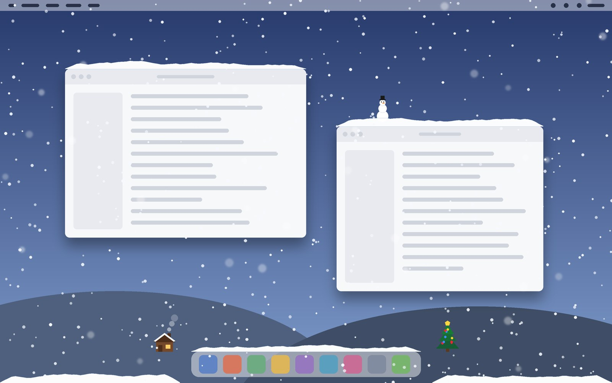
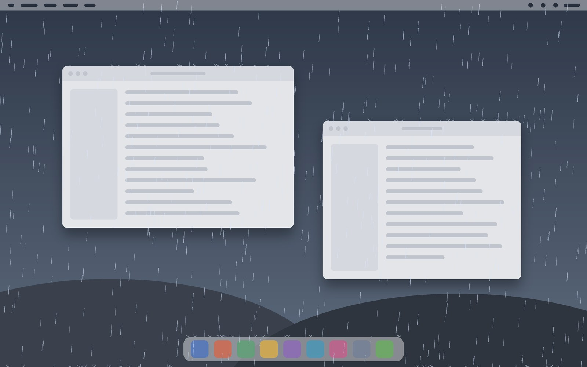
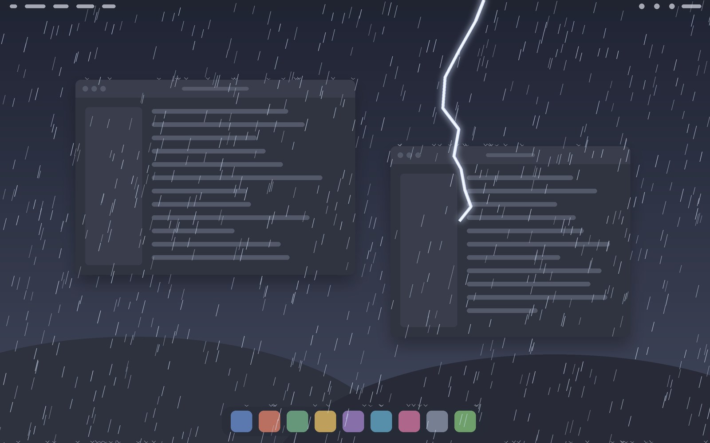
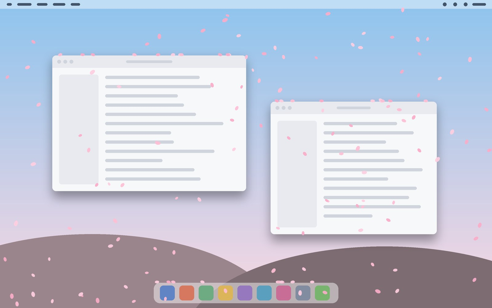
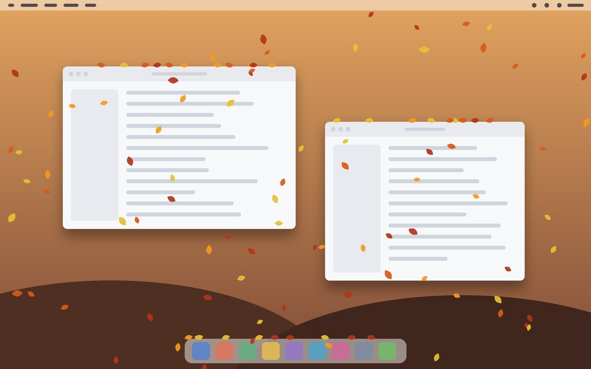
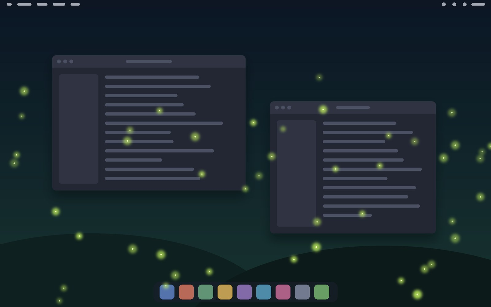
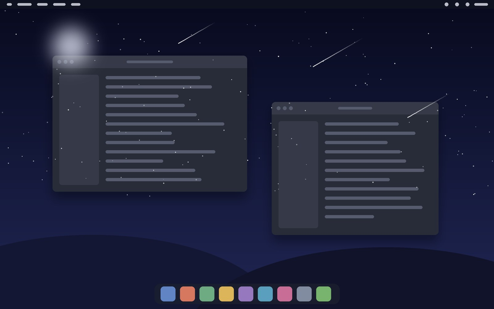
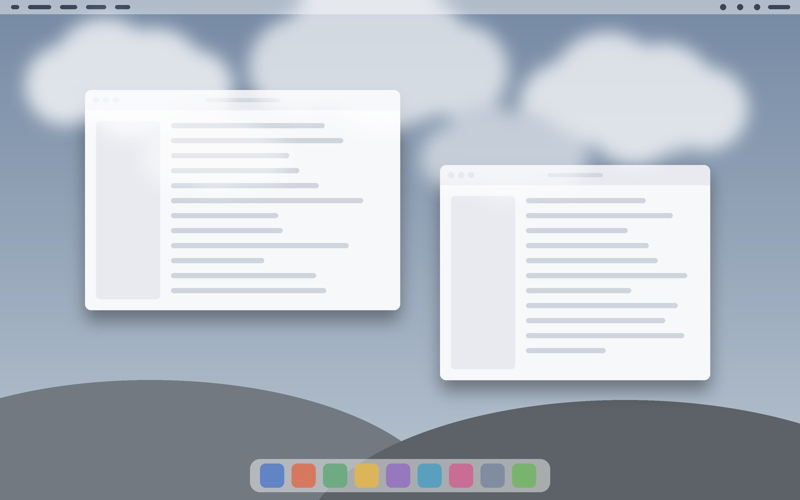
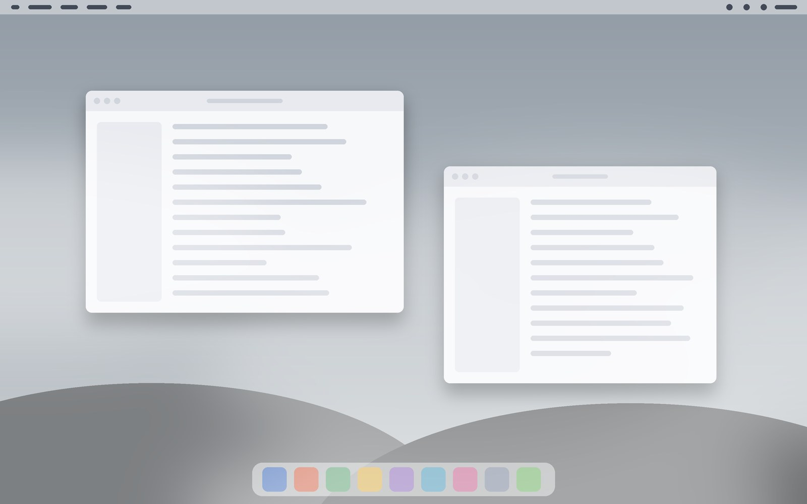

# Nimbo

**English** · [Español](#español)

Live weather on your Mac desktop. Snow gathers on your windows and the Dock, rain splashes on
window edges, and the scene changes on its own to match the real weather in your city.

Free. Requires macOS 14 or later (Apple silicon or Intel). Website: [nimbo.samdev.space](https://nimbo.samdev.space)

<p align="center"></p>

<table>
  <tr>
    <td align="center"><br>Snow</td>
    <td align="center"><br>Rain</td>
    <td align="center"><br>Storm</td>
  </tr>
  <tr>
    <td align="center"><br>Petals</td>
    <td align="center"><br>Leaves</td>
    <td align="center"><br>Fireflies</td>
  </tr>
  <tr>
    <td align="center"><br>Meteors</td>
    <td align="center"><br>Cloudy</td>
    <td align="center"><br>Mist</td>
  </tr>
</table>

<sub>Illustrations of each scene on a sample desktop, not screenshots.</sub>

## Install

The easiest way: open Terminal, paste this and press Return. It downloads Nimbo, installs it in Applications and opens it, with no security warning.

```bash
curl -fsSL https://nimbo.samdev.space/install.sh | bash
```

Or download [Nimbo.dmg](https://github.com/samRgarcia/nimbo/releases/latest/download/Nimbo.dmg),
open it and drag Nimbo into Applications. It shows up as an icon in the menu bar.

If you use the `.dmg`: Nimbo is not notarized by Apple yet, so macOS will block it the first time:
go to System Settings › Privacy & Security and click "Open Anyway".

## Features

- **Ten scenes**: snow, rain, petals, leaves, fireflies, meteors, storm, cloudy, mist and clear.
- **Real weather**: pick your city in Settings. Nimbo checks Open-Meteo every 15 minutes (no API key)
  and shows the forecast for the next 24 hours.
- **Windows**: snow piles up on the top edge of each window and falls when you move or close it.
  Sweep the cursor quickly over a pile to scatter it.
- **Winter workshop** (menu): snowman, Christmas tree with ornaments, snowplow and a cabin with a chimney.
- **Snowballs**: hold Option and move the cursor over the snow; stack three to build a snowman.

## Performance

- Calm scenes run at 30 frames per second and fast-falling ones at 60.
- **Energy saver** (or macOS Low Power Mode) drops everything to 30 frames and uses fewer particles.
- It stops by itself when the screen is off or the session is locked, and hides in full-screen apps.

## Privacy

Only the rounded coordinates of the city you choose are sent to Open-Meteo.
Window positions never leave your Mac, and the app asks for no permissions.

## Build from source

```bash
./build-app.sh
```

Requires the Xcode command line tools. The app is created at `build/Nimbo.app`.

## Regenerate the illustrations

```bash
python3 docs/illustrations.py
```

Draws the sample desktop for each scene into `docs/screenshots/`. Requires Pillow.

## Publish a release

```bash
bash release.sh
```

Builds the universal `.dmg` and uploads it to GitHub Releases. The version number comes from `Support/Info.plist`.

## Website and video

- `website/` is the landing page: one static `index.html`, English and Spanish, with a live demo of the scenes. On Vercel, set **Root Directory** to `website`; there is no build step.
- `video/` is the 30-second promo video, made with [HyperFrames](https://github.com/heygen-com/hyperframes). `bash video/render.sh` renders it in both languages into `website/media/`.

## Project layout

| File | Contents |
| --- | --- |
| `NimboMain.swift` | Startup, menu bar icon and menu |
| `Models.swift` | Scenes, saved state and weather codes |
| `WeatherService.swift` | Open-Meteo requests |
| `OverlayController.swift` | Transparent windows, one per screen |
| `WeatherScene.swift` | Particles, snow build-up, mouse and workshop |
| `Ledge.swift` | Ledges where snow gathers |
| `WindowTracker.swift` | Window positions |
| `SettingsView.swift`, `LoginItem.swift` | Settings window and open at login |
| `Textures.swift`, `Decor.swift` | Textures and decorations drawn in code |

## Credits

Weather data by [Open-Meteo](https://open-meteo.com/), licensed under CC BY 4.0.

---

## Español

[English](#nimbo) · **Español**

Clima vivo sobre el escritorio de tu Mac. La nieve se junta sobre las ventanas y el Dock,
la lluvia salpica en los bordes y la escena cambia sola según el clima real de tu ciudad.

Gratis. Requiere macOS 14 o posterior (Apple silicon o Intel). Sitio: [nimbo.samdev.space](https://nimbo.samdev.space)

### Escenas

<p align="center"></p>

<table>
  <tr>
    <td align="center"><br>Nieve</td>
    <td align="center"><br>Lluvia</td>
    <td align="center"><br>Tormenta</td>
  </tr>
  <tr>
    <td align="center"><br>Pétalos</td>
    <td align="center"><br>Hojas</td>
    <td align="center"><br>Luciérnagas</td>
  </tr>
  <tr>
    <td align="center"><br>Meteoros</td>
    <td align="center"><br>Nublado</td>
    <td align="center"><br>Neblina</td>
  </tr>
</table>

<sub>Ilustraciones de cada escena sobre un escritorio de ejemplo, no capturas reales.</sub>

### Instalar

La forma más fácil: abre la Terminal, pega esto y pulsa Enter. Descarga Nimbo, la instala en Aplicaciones y la abre, sin el aviso de seguridad.

```bash
curl -fsSL https://nimbo.samdev.space/install.sh | bash
```

O descarga [Nimbo.dmg](https://github.com/samRgarcia/nimbo/releases/latest/download/Nimbo.dmg),
ábrelo y arrastra Nimbo a Aplicaciones. Aparece como un icono en la barra de menús.

Si usas el `.dmg`: Nimbo todavía no está notarizada por Apple, así que macOS la bloqueará la primera vez:
ve a Ajustes del Sistema › Privacidad y seguridad y pulsa "Abrir igualmente".

### Qué hace

- **Diez escenas**: nieve, lluvia, pétalos, hojas, luciérnagas, meteoros, tormenta, nublado, neblina y despejado.
- **Clima real**: elige tu ciudad en Ajustes. Nimbo consulta Open-Meteo cada 15 minutos (sin clave)
  y muestra el pronóstico de las próximas 24 horas.
- **Ventanas**: la nieve se acumula en el borde superior de cada ventana y cae al moverla o cerrarla.
  Pasa el cursor rápido por un montón para esparcirlo.
- **Taller de invierno** (menú): muñeco de nieve, árbol de Navidad con adornos, quitanieves y cabaña con chimenea.
- **Bolas de nieve**: mantén Opción y mueve el cursor sobre la nieve; apila tres para armar un muñeco.

### Rendimiento

- Las escenas tranquilas corren a 30 cuadros por segundo y las de caída rápida a 60.
- **Ahorro de energía** (o el modo de bajo consumo de macOS) baja todo a 30 cuadros y usa menos partículas.
- Se detiene sola con la pantalla apagada o la sesión bloqueada, y se oculta en apps a pantalla completa.

### Privacidad

Solo se envían a Open-Meteo las coordenadas redondeadas de la ciudad elegida.
La posición de las ventanas nunca sale de la Mac, y la app no pide permisos.

### Compilar desde el código

```bash
./build-app.sh
```

Requiere las herramientas de línea de comandos de Xcode. La app queda en `build/Nimbo.app`.

### Regenerar las ilustraciones

```bash
python3 docs/illustrations.py
```

Dibuja el escritorio de ejemplo de cada escena en `docs/screenshots/`. Requiere Pillow.

### Publicar una versión

```bash
bash release.sh
```

Genera el `.dmg` universal y lo sube a GitHub Releases. El número de versión sale de `Support/Info.plist`.

### Sitio web y video

- `website/` es la página de presentación: un solo `index.html` estático, en inglés y español, con una demostración en vivo de las escenas. En Vercel, pon **Root Directory** en `website`; no hay paso de compilación.
- `video/` es el video de 30 segundos, hecho con [HyperFrames](https://github.com/heygen-com/hyperframes). `bash video/render.sh` lo genera en los dos idiomas dentro de `website/media/`.

### Estructura

| Archivo | Contenido |
| --- | --- |
| `NimboMain.swift` | Arranque, icono y menú de la barra |
| `Models.swift` | Escenas, estado guardado y códigos de clima |
| `WeatherService.swift` | Llamadas a Open-Meteo |
| `OverlayController.swift` | Ventanas transparentes, una por pantalla |
| `WeatherScene.swift` | Partículas, acumulación de nieve, ratón y taller |
| `Ledge.swift` | Repisas donde se junta la nieve |
| `WindowTracker.swift` | Posición de las ventanas |
| `SettingsView.swift`, `LoginItem.swift` | Ventana de ajustes y abrir al iniciar sesión |
| `Textures.swift`, `Decor.swift` | Texturas y adornos dibujados por código |

### Créditos

Datos del clima de [Open-Meteo](https://open-meteo.com/), bajo licencia CC BY 4.0.
